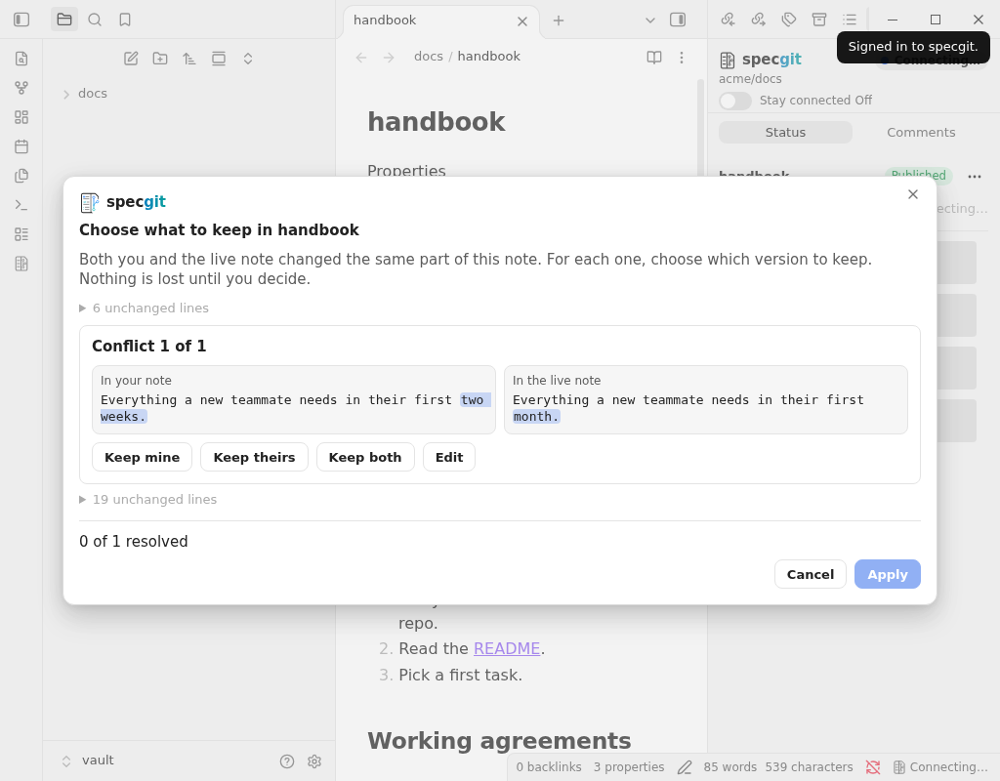
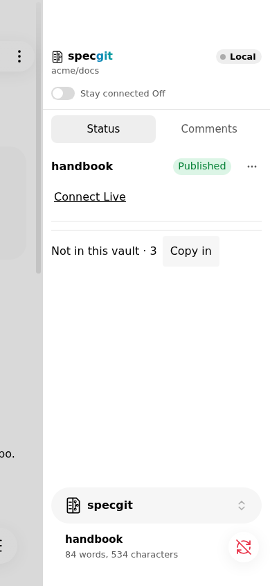

# specgit for Obsidian

**Write notes with your team, live, and send them for review in your own GitHub repository.**

A vault on GitHub is a good home for a team's notes. Writing in it together is the hard part. Two people change the same note, and one of them loses their words. Feedback lands somewhere else, far from the sentence it's about. And sending anything for review means someone on the team has to run Git.

specgit already solves this for Obsidian vaults in your browser. This plugin brings it inside Obsidian: the same live editing together, the same comments, and the same easy path to GitHub. It works in Obsidian on your computer and on your phone. The plugin is free, and specgit has a free plan.

## Write together, live

You open the spec you're writing. It starts **Local**: an ordinary note that nobody else sees. When you want your tech lead in it, you choose **Connect Live** in the specgit panel. They can join from their own Obsidian, from specgit in a browser, or through an agent. You see their cursor with their name, and what either of you types shows up for both. Undo only takes back your own words. When you're done, **Disconnect** makes the note Local again and stops sharing right away.

If anything changed while you were away, specgit tells you when you connect, and **See changes** shows you what. If you and your tech lead changed the same words, specgit shows you each place before it changes anything. For each one, you keep yours, keep theirs, keep both, or edit it yourself. Nothing is chosen for you. If you close that screen, your note stays Local, and nothing is lost.

## Talk about the exact words

Your tech lead isn't sure about one requirement. They select it and choose **Comment with specgit**, and those words are underlined in your note. You read the question in the panel's **Comments** tab, reply, and resolve it once you agree. Anyone can reopen it later. When they suggest new wording, **Apply suggestion** puts it into your note. The underlines are only marks on the screen. They never change your note.

## Send it for review, then publish

The panel's **Status** tab keeps track of everything in progress: the notes, Canvas boards and Bases files you changed, the reviews you sent, and the reviews waiting for you. Each one is marked with where it stands, like **Draft**, **In review** or **Ready to publish**. When the spec is ready, you choose **Submit for review** and pick your tech lead. If you finished three notes, you tick all three and send them together. On the Pro and Pro Plus plans, **Group together** sends several notes as one review.

Your tech lead approves the spec or asks for changes, from Obsidian or from specgit in a browser. Once it's approved, you choose **Publish**, and the spec becomes the version everyone sees in your GitHub repository. Publishing is always your click, and every save leaves an audit trail.

## Stay connected all day

Some days you're in the vault from morning to night. **Stay connected** is off until you turn it on, with the switch at the top of the panel. While it's on, your whole vault stays up to date without opening each note, and notes open Live. A few seconds after you stop typing, your edits are saved to a draft. Nothing goes for review until you choose. Your teammates' changes, and your own from your other devices, come into your notes by themselves. Where you and a teammate changed the same words, nothing changes until you choose. You decide whether teammates' unpublished changes are added to your notes (the default) or offered to you first. Stay connected never publishes, and it never sends a delete on its own.

## No repository yet?

If your vault lives only on your computer, or in a folder like Google Drive, choose **Put this vault on GitHub**. It's free. specgit makes a new repository on your GitHub account and uploads your vault to it. The details are below.

For everything else specgit does, visit [specgit.com](https://specgit.com) whenever you like.

## Putting a vault on GitHub

- **It's free.** It doesn't count toward your plan's limits. After that, your plan applies as usual. On the Free plan, this is your one repository.
- **The new repository** is named after your vault and is private. You can change the name, or make it public, before you start.
- **What goes up:** your notes, Canvas boards, Bases files, attachments and Obsidian settings, including themes and CSS snippets. specgit also adds a small file named `.gitignore` that keeps everything else out.
- **What stays on your computer:** community plugins and their settings, because they can hold passwords and keys. Obsidian installs them again from your plugin list. The window layout, the trash and files over 20 MB stay too. specgit tells you how many files stay behind.
- **The first time,** GitHub opens a page to add specgit to your account. specgit can make a repository for you. It can't change a repository's settings, delete one or give one away.
- **While it uploads,** you can hide the upload, but keep Obsidian open. If the upload stops, **Continue** picks up where it left off.

## Get started

1. In Obsidian, open **Settings**, then **Community plugins**. Search for "specgit", install it and turn it on.
2. In **Settings**, open **specgit** and choose **Sign in**. Your browser opens specgit. Choose **Allow**, confirm with GitHub, then choose **Open Obsidian** to come back.
3. Choose **Choose repository** and pick the GitHub repository your notes are in. specgit finds the folder in your vault that matches it. Confirm it, or choose another folder or the whole vault. Notes outside that folder stay in this vault only, and the plugin never touches them.
   No repository yet? Choose **Put this vault on GitHub** instead.
4. If the repository has notes your vault doesn't, specgit offers to copy them in. It never writes over a note you already have.
5. Open a note and choose **Connect Live** in the specgit panel. To open the panel, click the specgit icon in the ribbon, or run the **Open specgit** command.

## What it looks like

The panel uses Obsidian's own colors and fonts, in light mode, dark mode and community themes. On a phone, the panel is in the right-hand drawer.

| | |
| --- | --- |
|  |  |

## Before you use it

- **A specgit account is required.** You sign in with GitHub.
- **Payment is optional.** The plugin is free, and specgit has a free plan.
- **Your notes need to be in a GitHub repository you can edit**, or one the plugin makes for you. specgit saves to that repository. The plugin never writes to GitHub itself.

## Plans

- **Free:** unlimited collaborators, so your whole team can comment, write drafts and edit live. 1 repository and 5 publishes a month.
- **Pro:** unlimited repositories and unlimited publishes, plus **Group together**. You pay for editors only. Viewers and commenters are free.
- **Pro Plus:** everything in Pro, plus agent usage included every month.

Prices and full details are at [specgit.com/pricing](https://specgit.com/pricing).

## Privacy

Zero Content Retention: we never keep a copy of your documents or comments. While people are editing a note, specgit's service holds the note's live state, then saves the note to your GitHub repository. Our privacy policy says how long the live state is kept: [specgit.com/privacy](https://specgit.com/privacy).

### Who the plugin talks to

The plugin talks to three services and nothing else. It has no analytics or tracking of any kind.

**specgit.com**, to:

- sign you in, and get your GitHub login, your name and the address of your profile picture
- tell you how many people are in a note before you connect (just the number, and nobody is told you asked)
- get a short-lived token for each note you connect
- get GitHub's copy of a note when the plugin needs to compare it with yours
- read, post and resolve comments
- list your repositories, and the names and file IDs of the files in the one you chose, for the Status tab (never the files' text)
- send notes for review and publish them, only when you press the button
- make a repository and upload your vault, only when you choose **Put this vault on GitHub**
- send a problem report, only when you press **Send**

**specgit's live service** (`wss://specgit.com/realtime`), to share a live note's text and your cursor with the people in it.

**GitHub's picture servers** (`avatars.githubusercontent.com` and `private-avatars.githubusercontent.com`), to show people's profile pictures. The plugin asks only for the picture. It sends no token, and it doesn't say which note the picture is for. It loads pictures only from these two addresses. Otherwise it shows the person's initials.

Your notes and comments reach GitHub only through specgit. The pictures are the only thing the plugin asks GitHub for directly.

Settings has an Advanced section that can point the plugin at a different specgit server.

### What leaves your device

- **The text of notes you connect**, as you type, so the people in the note can see it. Notes you haven't connected send nothing.
- **A note's location, without its text.** When the plugin asks for GitHub's copy of a note (for example, the first time you open it), it sends the repository's name and the note's location in it.
- **Your name, GitHub login, profile picture address and cursor position**, so people in a note can see who's there.
- **Comments you send**, with the words you selected. specgit posts them to your repository as review comments.
- **Your vault's files**, only when you choose **Put this vault on GitHub**. specgit keeps no copy.
- **A problem report**, only when you press **Send**. You see it first and can edit it. It holds what you wrote, and your email address if you give one. If you turn on **Include setup details**, it also holds: the plugin and Obsidian versions, your operating system, whether you're on a computer, tablet or phone, the repository's name, whether you're signed in, and whether the open note is Local or Live. It never holds a note's name, location or text, or your token. It goes to specgit's support inbox under your GitHub login. We can reply only if you give an email address. If you're signed out, nothing is sent: the plugin copies your report and opens specgit's support page.
- **A sign-in token**, so specgit knows it's you. It's kept in Obsidian's secure storage (encrypted from Obsidian 1.11.5), not in your vault's files. Signing out ends it.

### What stays on your device

- **Your settings:** the repository and folder you chose, your cursor color, your GitHub login, name and picture address, and the server. They're in the plugin's `data.json` file in your vault's `.obsidian` folder. Whether Stay connected is on is kept on this device only.
- **A short record of each file** in that folder (its size, when it last changed, and its file ID), so the Status tab only checks what changed.
- **Copies of notes you connect:** the text from when a note last matched its live copy, and the text it started as. These let specgit combine changes made while you were offline instead of writing over them. It keeps up to 300 notes and about a million characters, and drops the oldest first.

The file record and the note copies are kept in Obsidian's own storage for this vault. They aren't in your vault, aren't synced to your other devices, and aren't saved to your repository.

- **Which notes are connected, and the comments the panel shows**, only while Obsidian is open.
- **An unfinished upload's details** (the new repository's name and when the upload began), so **Continue** can pick it up. They're removed when the upload finishes, or after 30 days.
- **Problem reports are never kept** on your device.

The plugin creates no files of its own. The only files it adds to your vault are notes from your repository that you asked for, through **Copy them in** or Stay connected. It never writes over a note you already have. With Stay connected on, it also brings your team's changes into your notes, as described above.

### Files outside your vault

On a computer, and only while Stay connected is on, the plugin reads Git's own log for the repository your vault is in. That's the `HEAD` log and the stash log, in the `.git` folder of your vault's folder or a folder above it, or wherever a `.git` file there points. It checks about once a second. It does this only to tell a change Git made apart from your own typing, so a change Git made is never sent as yours. It reads nothing else outside your vault, writes nothing there, and sends none of it anywhere.

On a phone, it reads nothing outside your vault.

### Open source

The plugin is open source under the MIT license. specgit's service (the website and the live service) isn't open source.

## Questions or a problem?

Use **Report a problem** in the plugin's settings, or go to [specgit.com/support](https://specgit.com/support).

## Build

    npm ci
    npm run build

Made by FnFirst.
