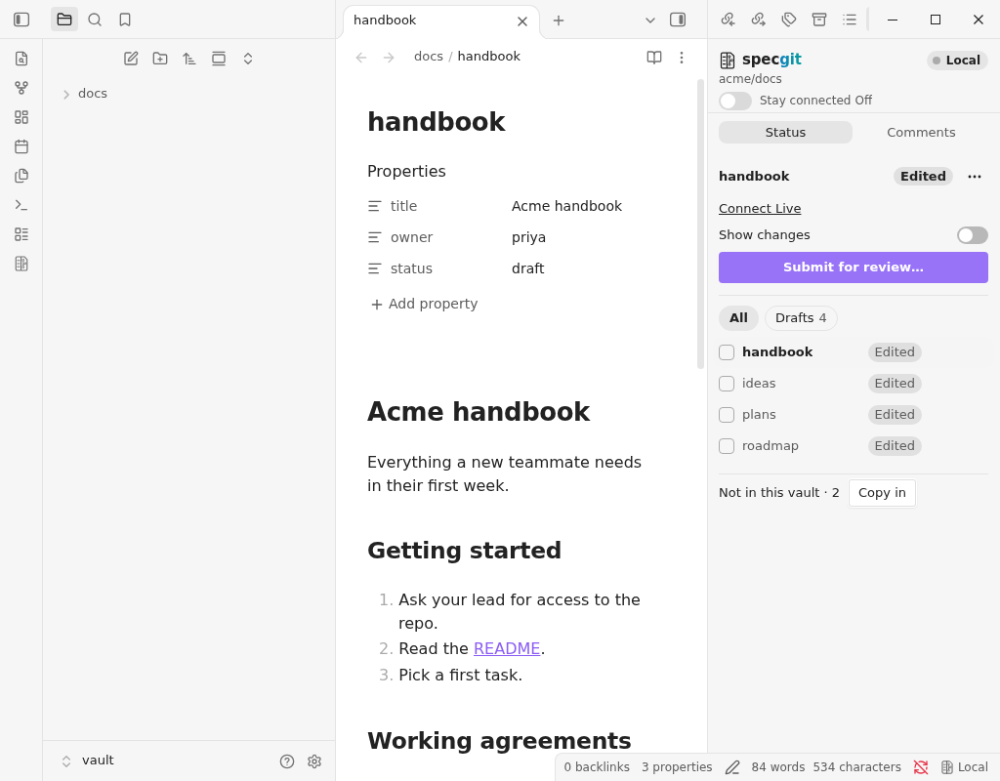
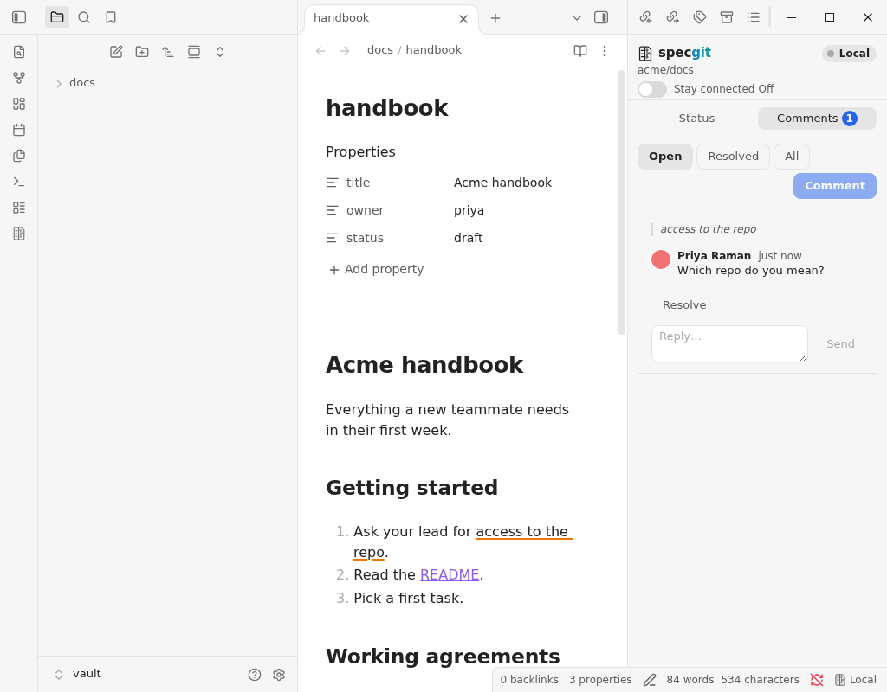
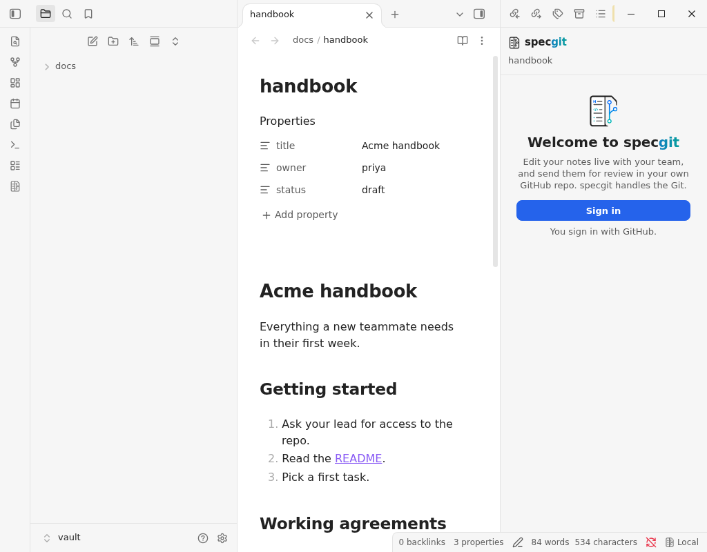
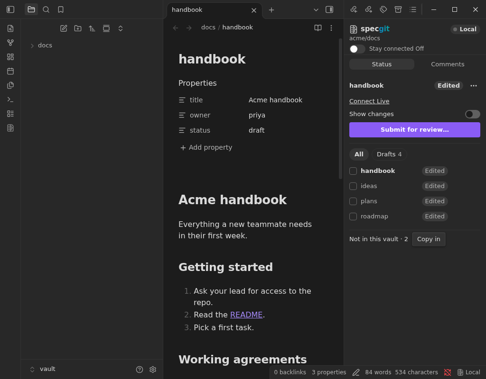

# specgit for Obsidian

**Edit notes live, auto-sync your vault, comment inline, and review or publish changes to your GitHub repository without thinking about Git.**

GitHub is a dependable home for an Obsidian vault: every edit has an author and a history, and engineers already work there. Keeping a vault in step across devices or writing in it with a team is where things break down. Concurrent edits collide, feedback gets scattered across tools, and publishing asks everyone to learn Git.

[specgit.com](https://specgit.com) already gives individuals and teams a visual editor for Obsidian vaults in the browser, keeping your Markdown, Canvas boards, and Bases files intact. This plugin brings the best of specgit inside Obsidian on desktop and phone, connecting everyday actions (saving, commenting, and publishing) directly to how GitHub works (commits, pull request review threads, and merges). Teammates can join you from their own Obsidian app, from a browser on specgit.com, or through a connected agent, while your GitHub repository stays the source of truth.

The plugin is free and open source (MIT), specgit includes a Free plan, and Zero Content Retention means we never keep a copy of your documents or comments.



## What you can do

### Live editing, when you want it

Every note starts **Local** as an ordinary Markdown file that stays on your device. When you want to collaborate, select **Connect Live** in the specgit panel. Teammates editing the same note in Obsidian, on [specgit.com](https://specgit.com), or through a connected agent appear as live cursors with their names and avatars. Undo only reverts your own edits, and **Disconnect** returns the note to Local right away.

Nothing changes silently. If a note changed while you were offline or Local, specgit tells you when you connect and lets you inspect the diff with **See changes**. When two people edit the same lines, specgit opens a conflict resolution screen with one card per overlapping edit, letting you pick **Keep mine**, **Keep theirs**, **Keep both**, or **Edit**. Closing that screen leaves your note Local with nothing lost.


### Inline comments anchored to the text

Select any passage and choose **Comment with specgit** to open a review thread tied to those words. Read, reply, resolve, and reopen threads in the **Comments** tab, or apply a teammate's proposed wording with **Apply suggestion**. Comment highlights are visual markers only and never alter your Markdown.



### Review and publish from one Status panel

The **Status** tab tracks every draft, changed note, Canvas board, and Bases file in your linked folder, along with reviews waiting on you. Each row shows its state (**Draft**, **In review**, **Ready to publish**, and more). Select one or several files to **Submit for review**, assign reviewers, **Approve** or **Ask for changes** inside Obsidian, and **Publish** once approved.

On Pro and Pro Plus plans, **Group together** combines multiple related files into one review (a single pull request in GitHub) so they are reviewed and published as a set. Publishing always takes your explicit click.

Canvas live editing, Writing mode, Riff, and Ask Agent live on [specgit.com](https://specgit.com), one click away via **Open in specgit**.

### Background sync with Stay connected

**Stay connected** is off by default. Turn it on at the top of the panel to keep your linked folder in step without opening each note:

- Notes open live, and edits save to a draft a few seconds after you stop typing.
- Published changes and edits from your other devices flow into your vault automatically.
- You choose in settings whether teammates' unpublished drafts apply automatically or ask first.
- Overlapping edits always wait for your choice, and Stay connected never publishes or deletes files on GitHub on its own.

### Put a local vault on GitHub, free

If your vault isn't on GitHub yet, choose **Put this vault on GitHub** from the panel, the repository picker, or the command palette. specgit creates a private GitHub repository (or public, if you switch it) and uploads your vault.

- **Free and unmetered:** creating and uploading the repository doesn't count against your plan limits. After setup, your plan applies as usual (on Free, it becomes your one repository).
- **Uploaded:** notes, Canvas boards, Bases files, attachments (up to 100 MB each), Obsidian settings, themes, CSS snippets, and a `.gitignore` file.
- **Kept local:** community plugins and their settings (so passwords and API keys never leave your device), window layouts, Obsidian's trash, and files over 100 MB (listed before upload starts).
- **Scoped permissions:** GitHub asks once to let specgit create repositories on your account. specgit cannot change repository settings, delete a repository, or transfer one.
- **Resumable:** you can hide the progress view while keeping Obsidian open; if interrupted, **Continue** picks up where it left off.

## Get started

1. Open **Settings → Community plugins**, search for `specgit`, install it, and turn it on.
2. Open **Settings → specgit** and select **Sign in**. Your browser opens specgit to confirm with GitHub and returns you to Obsidian.
3. Select **Choose repository** to pick an existing GitHub repository and confirm the matching vault folder, or select **Put this vault on GitHub** to create a new one. Notes outside the linked folder are never touched.
4. If the repository has notes missing from your vault, select **Copy them in** (existing files are never overwritten).
5. Open a note and select **Connect Live** in the specgit panel (open it from the ribbon icon or the **Open specgit** command).



## Desktop and mobile

The panel uses Obsidian's native colors and typography across light mode, dark mode, and community themes. On mobile, it opens in the right sidebar drawer.

| Dark theme | Mobile |
| --- | --- |
|  |  |

## Requirements and plans

- **Account required:** you sign in with GitHub to use specgit.
- **Payment optional:** the plugin is free and open source, and specgit includes a Free plan.
- **GitHub repository:** your notes live in a GitHub repository you can edit (read-only repositories open live in read-only mode), or one created with **Put this vault on GitHub**.

| Plan | Price | Includes |
| --- | --- | --- |
| **Free** | $0 | Unlimited collaborators, 1 repository, 5 publishes a month |
| **Pro** | $8/seat/month ($6.40/seat/month billed yearly) | Unlimited repositories, unlimited publishes, **Group together** |
| **Pro Plus** | $16/seat/month ($12.80/seat/month billed yearly) | Everything in Pro, plus $10/month of agent usage per seat on specgit.com |

Only editors use paid seats; viewing and commenting are free. Full details are at [specgit.com/pricing](https://specgit.com/pricing).

## Privacy and disclosures

Zero Content Retention: we never keep a copy of your documents or comments. While people edit a note together, specgit holds temporary live-editing state to sync and save changes to your GitHub repository. See retention details in the [Privacy Policy](https://specgit.com/privacy).

The plugin contains no client-side analytics or tracking.

### Network services used

| Service | Purpose |
| --- | --- |
| `specgit.com` | Sign-in (GitHub login, display name, avatar URL), pre-connect room presence count, short-lived room tokens, GitHub file comparisons, reading/posting/resolving comments, repository and file metadata for the Status tab (names and Git IDs, never file text), submitting reviews and publishing on your click, creating/uploading a vault on **Put this vault on GitHub**, and sending **Report a problem** submissions when you press **Send**. |
| `wss://specgit.com/realtime` | Real-time sync of live note text and cursor positions with other people in the note. |
| `avatars.githubusercontent.com` and `private-avatars.githubusercontent.com` | Loading collaborator profile pictures. No auth token or note metadata is sent; initials are shown if unavailable. |

Your notes and comments reach GitHub only through specgit; profile pictures are the only direct requests to GitHub. An **Advanced** setting lets developers point the plugin at a custom specgit server.

### Data leaving your device

- **Live note text:** only for notes you explicitly connect (or while **Stay connected** is enabled). Local notes send nothing.
- **Repository name and note path:** sent without note text when comparing a note against GitHub.
- **Identity and cursor position:** your name, GitHub login, avatar URL, and cursor position while in a live note.
- **Comments:** your comment text and selected passage, posted to GitHub as review comments.
- **Vault files on onboarding:** only when you run **Put this vault on GitHub**; specgit keeps no copy.
- **Problem reports:** only when you press **Send** in **Report a problem**. You review and edit the text first. With **Include setup details** enabled, it attaches plugin/Obsidian versions, OS and device type, repository name, sign-in state, and whether the active note is Local or Live (never note names, paths, text, or tokens). Signed-out reports are copied locally instead of sent.
- **Auth token:** stored in Obsidian's encrypted secret storage (Obsidian 1.11.5+), never in your vault files, and cleared on sign-out.

### Data stored locally

- **Settings (`data.json`):** chosen repository, linked folder, cursor color, GitHub profile metadata, and server URL. The **Stay connected** toggle is stored per device only.
- **File change index:** file sizes, modified times, and Git IDs for the linked folder, kept in Obsidian's per-vault local storage (outside your vault and not synced) so the Status tab only hashes changed files.
- **Merge base cache:** recent matched text for connected notes (up to 300 notes / ~1 million characters, oldest evicted first) in Obsidian's per-vault local storage, used to merge offline changes cleanly.
- **Temporary state:** connected note state and loaded comments exist in memory only while Obsidian is open. Interrupted **Put this vault on GitHub** metadata clears on completion or after 30 days. Problem reports are never saved on disk.

The plugin creates no files of its own in your vault beyond notes you explicitly pull in via **Copy them in** or **Stay connected**.

### Files accessed outside your vault

On desktop only, and only while **Stay connected** is enabled, the plugin reads `.git/logs/HEAD` and `.git/logs/refs/stash` (inside your vault's `.git` folder, a parent `.git` folder, or the target of a `.git` file) about once per second. This distinguishes Git operations like `pull` or `checkout` from your own typing so Git changes aren't submitted as new edits. The plugin reads nothing else outside your vault, writes nothing there, and sends none of it off your device. On mobile, it accesses nothing outside your vault.

### Open source and license

This plugin is open source under the [MIT License](LICENSE). The specgit web app and realtime service are closed source.

## Support

Use **Report a problem** in **Settings → specgit**, or visit [specgit.com/support](https://specgit.com/support).

## Build from source

```bash
npm ci
npm run build
```

Made by FnFirst.
